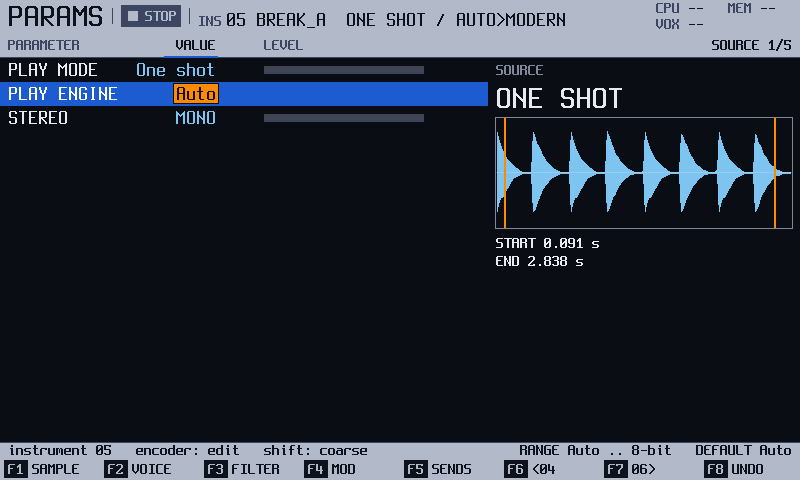

# Instrument
<!-- sync: src=model/src/params.cpp,app/src/param_access.h,app/src/save_service.cpp,hal/include/o3os/hal/storage_write.h,app/src/sample_bank.cpp,audio/include/o3os/audio/smoothing.h,audio/include/o3os/audio/paula.h qa=QA-INS-072,QA-INS-077,QA-INS-060 -->
<!-- manual-sync: f5e29c02 -->

Status: draft

Instrument gathers everything about one sound on five pages, SOURCE, VOICE, FILTER, MOD and SENDS on `F1` to `F5`, and puts copy, paste, delete and save on the Shift row. An empty slot opens a type chooser instead of a page. The PLAY ENGINE row picks how a sample is played, from the clean Modern engine down to the Amiga's 8-bit sound. The official manual has two parameter pages on the `Params` button. Here there are five pages on `F1` to `F5`, and `Left` and `Right` change the value of the row, like one click of the encoder. <!-- og: different --> Not checked against the original firmware: the Shift row and the type chooser. <!-- og: open -->

<!-- Sources: docs/qa/catalogue/instrument.md (QA-INS-001..064, 082..089, 200..210 where a player meets them), docs/ui/ui-map.md section 1 (Instrument row), glossary.md. -->
<!-- Images for docs/manual/images.txt (manifest not written yet): instrument_qa_ins_005 (shot qa/qa_instrument.txt qa_ins_005), instrument_qa_ins_035 (shot qa_ins_035), instrument_qa_ins_061 (shot qa_ins_061). -->
<!-- Not written here, own page needed: module instrument pages (F1 to F4), the Instr-hold list (QA-INS-060). -->
<!-- No player-facing text: QA-INS-083 and QA-INS-084 (file versions, only the older-reader line is written), QA-INS-091 (an artefact not reproduced), QA-INS-096 (a bench), QA-INS-213 (a console line, see the computer tools chapter). -->

## What it is for

Use Instrument to set how an instrument sounds and plays. Open it with the `Params` button. A project has 64 instrument slots. An empty slot opens the type chooser: **SAMPLE**, **MIDI**, **MODULE**, or a file to load.

## How it works
<!-- sync: src=app/src/screens/params_screen.cpp,app/src/param_access.h qa=QA-INS-021,QA-INS-032,QA-INS-085 -->

An instrument is one of the 64 slots of the project, and it is stored with the project. Every row you turn is live: the sound follows each step while a pad is held, and nothing waits for a confirm key. <!-- QA-INS-085 --> Your edits are kept in the project when you save it, and `Shift` + `F5` (**SAVE**) writes a copy of a sample instrument to its own `.pti` file that other projects can load. <!-- QA-INS-052 -->

Nothing here "ends" by itself: a value stays until you change it. `Delete` puts the row under the cursor back to its default, `Shift` + `Delete` sets every row to its default, and `F8` (**UNDO**) takes back the last change. A sweep of the encoder on one row is one undo step, and a pause of 1.5 seconds starts a new one. <!-- QA-INS-021, QA-INS-032, QA-INS-085 -->

The pads play the instrument in view, so you hear each change while you hold a pad. Example: on a sample instrument, open the FILTER page, move to **CUTOFF**, hold a pad and turn the encoder. The filter closes under your finger, and one `F8` puts it back.

### The volume law
<!-- sync: src=audio/src/graph.cpp qa=QA-INS-202,QA-INS-203,QA-INS-200,QA-INS-201,QA-INS-205,QA-INS-206,QA-INS-207,QA-INS-209,QA-INS-210 -->

The **VOLUME** row (on the VOICE page) sets the level. The volume law turns it into decibels (dB). An older project keeps its loudness when saved and reloaded.

| Project | VOLUME 50 | VOLUME 100 |
|---|---|---|
| A native project, or an original-firmware project of version 7 or later | 0 dB | +24 dB |
| An original-firmware project below version 7 | about -20 dB | 0 dB |

If you want to know more: a module imported from a tracker file keeps its loudness; volume 64 becomes level 50, which is 0 dB (checked on the host). The Amiga engine gives the same dB as the Modern one. <!-- QA-INS-202, QA-INS-203 -->

Between the marked points, each step of **VOLUME** is 0.48 dB in the first law (volume 1 is -24 dB, and 0 is silence) and 0.4 dB in the second. Not checked by ear on the unit.

A project saved by an earlier build can sound at a different level, and the stored levels stay as they were. A note that names no velocity, on a native instrument at level 80, now plays at 0 dB; it played at +24 dB. On the Amiga engine levels 50 and 80 both play full volume. A module imported now gives its instruments velocity 63, so a Roll that fades with VolUp or VolDown peaks about 6 dB lower and sits 6 dB under a plain note. The demo kit stays at 0 dB after any edit. Not yet checked on the unit, except the demo kit. <!-- QA-INS-211, QA-INS-212, QA-INS-204 -->

<!-- QA-INS-200, QA-INS-201, QA-INS-205, QA-INS-206, QA-INS-207, QA-INS-209, QA-INS-210: the law belongs to the project; a sample added to an older project plays at 0 dB at VOLUME 100. -->

### The play engine
<!-- sync: src=app/src/sample_bank.cpp,audio/include/o3os/audio/voices.h,audio/include/o3os/audio/paula.h qa=QA-INS-006,QA-INS-003,QA-INS-203 -->

The **PLAY ENGINE** row picks the engine for a sample: **Auto**, **Modern**, **Amiga**, **12-bit** or **8-bit**. **Auto** picks the Amiga engine for a **ONE SHOT** or **LOOP FWD** sample at the Paula rate, and the Modern engine for the rest. Paula is the Amiga's sound chip. Its rate here is 8,287 Hz (PAL) or 8,363 Hz (NTSC). The Amiga engine plays a sample as that chip does: it holds each value until the next one, and uses 8 bits of it. The **12-bit** and **8-bit** engines are the Modern engine with its output cut to 12 or 8 bits, and cap the **BIT DEPTH** row the same way. <!-- QA-INS-006, QA-INS-003 -->

The **STEREO** row under it says whether a sample plays as a stereo pair: **MONO** or **STEREO**. This is new in track3r-os, and for now it only prepares the ground: no sample has a stereo load yet, so turning it to **STEREO** is refused with `STEREO NEEDS A STEREO LOAD`, and the row stays **MONO**. Nothing about the sound changes. <!-- QA-INS-224, QA-INS-225 -->

If you want to know more: a full-scale square wave on the Amiga engine peaks at +2.5 dB above its level. It matches a reference Amiga player on the host. Not yet checked on the unit. <!-- QA-INS-203 -->

## Try it
<!-- sync: src=app/src/screens/params_screen.cpp qa=QA-INS-005,QA-INS-085 -->

This walk-through sweeps the filter of the instrument in view and takes the sweep back.

1. Press `Params`. The Instrument screen opens on the SOURCE page.
2. Press `F3` (**FILTER**). The cursor starts on **FILTER**, the first row.
3. Press `Down` twice. The cursor passes **FILTER TYPE** and is on **CUTOFF**, which reads **30 %** in the demo project. <!-- QA-INS-085 -->
4. Hold a pad and turn the encoder 20 clicks to the left. **CUTOFF** falls to **10 %** and the sound gets darker with each click.

   
5. Let go of the pad and press `F8` (**UNDO**). The whole sweep is taken back in one step: **CUTOFF** reads **30 %** again. <!-- QA-INS-085 -->

   

Hold the pad again and the sound is as bright as before.

## The screen at a glance
<!-- sync: src=app/src/screens/params_screen.cpp -->

| Area | What it shows |
|---|---|
| Header | The number and name, then the play mode and the engine, such as `05 BREAK_A` and `ONE SHOT / AUTO>MODERN`. A MIDI instrument shows its channel instead, such as `MIDI / CH 3`. The kind is the label of `F1`: **SAMPLE** (**WT**, **GRAIN** or **SLICE** for those play modes) or **MIDI**. |
| Rows | The settings of the page. The encoder changes the value under the cursor. |
| Strip | Short messages, such as `INS 03 DELETED - F8 UNDO`. |
| Key row | `F1` to `F5` open the pages. `F6` and `F7` change the instrument. `F8` is **UNDO**. |
| Shift row | **NAME**, **COPY**, **PASTE**, **DELETE**, **SAVE**, the nearest-instrument keys and **REDO**. |

## More tasks

### Set the play mode of a sample

Start on a sample instrument.

1. Press `Params`. The SOURCE page opens. <!-- QA-INS-015 -->
2. Press `Down` to **PLAY MODE**. Turn the encoder through ONE SHOT, LOOP FWD, LOOP BWD, PING-PONG, SLICE, BEAT SLICE, WAVETABLE and GRANULAR. It stops at each end. <!-- QA-INS-019 -->
3. Press `Delete` on **PLAY MODE** to go back to ONE SHOT. <!-- QA-INS-021 -->

You should see the rows of the new mode. The waveform on the right follows each edit: the start and end (and the loop), the slice lines, the wavetable window or the grain, such as `GRAIN 50.0 MS AT 1.373 s` or `WINDOW 20 OF 0..63`. <!-- QA-INS-023 -->

| Play mode | Rows under PLAY MODE |
|---|---|
| WAVETABLE | WT POS, WT SIZE |
| GRANULAR | GRAIN POS, GRAIN LENGTH, GRAIN SHAPE, GRAIN LOOP |
| BEAT SLICE | SLICES, SLICE |

<!-- QA-INS-016, QA-INS-017, QA-INS-018. PLAY ENGINE and then STEREO are the last rows of every mode. -->

### Shape the sound: VOICE, FILTER and SENDS

Start on a sample instrument.

1. Press `F2` (**VOICE**). On the last row, **VEL>**, turn the encoder to scale the keyboard's velocity, 0 to 100 %. At 100 % (the default) velocity 64 plays as 64 of 127; at 50 %, as 96. <!-- QA-INS-082 -->
2. Press `F3` (**FILTER**), press `Down` twice to **CUTOFF**, and turn the encoder. A sweep is one undo step: `F8` (**UNDO**) takes it back. A pause of more than 1.5 seconds between two clicks starts a new step. <!-- QA-INS-085 -->
   While **FILTER** reads Off, **CUTOFF** and **RESONANCE** are dim and the info line says `FILTER OFF`: they still take the encoder, but you hear nothing until you turn the filter on. <!-- QA-INS-218 -->
3. Press `F5` (**SENDS**). Turn the encoder on **OVERDRIVE**. The sound saturates while the note plays; 0 is clean. <!-- QA-INS-002 -->

**VOLUME** and **GLIDE** are on the VOICE page. **BIT DEPTH** (4 to 16 bits) is on the SENDS page. <!-- QA-INS-003, QA-INS-004 -->

### Make an LFO move a setting
<!-- sync: qa=QA-INS-039,QA-INS-219,QA-INS-220,QA-INS-221 -->

An LFO is a slow wave that moves a setting, such as the volume. Each such setting is a destination. Start on a sample instrument.

1. Press `F4` (**MOD**). The header shows the destination, such as **DEST 1/6 Volume**. <!-- QA-INS-035 -->
2. Press `F4` again to move to the next of the six destinations. <!-- QA-INS-010 -->
3. Press `Down` to **SOURCE** and turn the encoder to **LFO**. The rows **LFO SHAPE**, **LFO SPEED** and **LFO AMOUNT** appear. <!-- QA-INS-036, QA-INS-038 -->
4. Hold a pad. For Volume, that is a tremolo at the tempo's rate. <!-- QA-INS-039 -->

You should see the shape under the rows. **LFO SHAPE**, **LFO SPEED**, **LFO AMOUNT** and **SOURCE** are heard at once on a held pad: the sound changes within a block, with no wait for the release. <!-- QA-INS-092, QA-INS-093, QA-INS-094, QA-INS-095 -->

**LFO SPEED** has 29 tempo-sync values, from `128 steps` to `1/64 step`. The Volume destination has the last 24, from `24 steps`. <!-- QA-INS-036 -->

A destination the instrument does not use is dimmed, not hidden, and the info line says why: `WAVETABLE ONLY`, `GRANULAR ONLY`, `FILTER OFF` or `SOURCE OFF: PICK ENVELOPE OR LFO`. A dim row can still be edited. <!-- QA-INS-037 -->

The LFOs of volume, pan, fine tune, cutoff and grain position also run while the transport is stopped, at the rate the tempo gives. Press `Play` with a pad held and the LFO goes on from where it is, with no jump. <!-- QA-INS-088, QA-INS-089, QA-INS-090 -->

The picture is a window of 16 steps (the label `16 STEPS` above it, the axis under it counts steps), so turning **LFO SPEED** changes it at once. At **16 steps** it shows one cycle, at **4 steps** four cycles, at **1 step** sixteen. A slower LFO shows only the start of its cycle: at **128 steps** (DEST 3/6, Cutoff) you see an eighth of it, a slow ramp. The volume LFO starts at 24 steps. Past 32 cycles (faster than **1/2 step**) the cycles are too small to read, so the picture is a filled band between the lowest and the highest level the shape reaches. **Random** shows made-up levels, one for each period; the real LFO picks its own. This picture is new in this firmware. <!-- QA-INS-219, QA-INS-220, QA-INS-221 -->

**LFO SHAPE** has six waves: Rev Saw, Saw, Triangle, Square, Random and **Sine**. Sine is new in this firmware and is not on the original firmware. It is a smooth wave that rises from nothing to the amount at the middle of the period and falls back, and it works like the others: the same speeds, the same amount, all six destinations, and it can be changed while a note sounds. If you export to the original firmware's format, a Sine LFO is written as Triangle and the export page lists it as **SINE LFO**. <!-- QA-INS-215, QA-INS-216, QA-INS-217, QA-FIL-114 -->

Not yet checked on the unit.

### Make a MIDI instrument
<!-- sync: qa=QA-INS-027,QA-INS-063,QA-INS-070,QA-INS-071,QA-INS-072,QA-INS-073,QA-INS-075,QA-INS-076,QA-INS-077,QA-INS-078,QA-INS-079,QA-INS-080 -->

Start on an empty slot.

1. Press `F2` (**MIDI**). The MIDI page opens with the row **CHANNEL**. Slots 1 to 48 start on channel 1; slots 49 to 64 start on the slot number minus 48. <!-- QA-INS-027 -->
2. Turn the encoder to set **CHANNEL**, from 1 to 16. <!-- QA-INS-063 -->
3. Hold a pad. The pad sends a note on that channel instead of playing a sound. <!-- QA-INS-033 -->

The other rows move one a click, `Shift` makes a coarse step, `Delete` puts the default, and each turn is one undo step. They stop at their ends. <!-- QA-INS-071 -->

| Row | Range (default) | What it does |
|---|---|---|
| **VELOCITY** | 1 to 127 (127) | The default velocity of its notes. |
| **PROGRAM** | **NONE**, 0 to 127 | Sends a Program Change on the channel when you edit it, and once before the first note after a project load. <!-- QA-INS-075, QA-INS-076 --> |
| **OUT** | **Config**, **DIN**, **USB**, **DIN + USB** (**Config**) | The port the notes and CCs go to. **Config** follows the MIDI OUT port of Config. <!-- QA-INS-077 --> |
| **PB RANGE** | 0 to 24 semitones (2) | Turns the Micro-tune FX into a pitch bend; 0 sends none. <!-- QA-INS-078 --> |
| **OFFSET** | 0 to 100 ms (0) | Delays the notes of this instrument. The length of a note is unchanged. <!-- QA-INS-080 --> |

Press `F2` (**CC**) for the controller page: six rows **CC A** to **CC F**, all **CONFIG** (the number set on the Config page) at first. `F1` and `F2` switch between the two pages. Turn a row through `CC 0` to `CC 127`, then **PROG**, **CH AT** and **POLY AT**. <!-- QA-INS-072, QA-INS-073 --> A step FX then sends the slot. With CC A at `CC 74`, CC B at **PROG**, CC C at **CH AT** and CC D at **POLY AT**, FX 8, 9, 10 and 11 send a controller, a Program Change, channel aftertouch and key aftertouch. **POLY AT** sends nothing when no note sounds. FX 37 sends **CC F**, not a Program Change; to send a Program Change, set a slot to **PROG**. <!-- QA-INS-079, QA-INS-069 -->

Notes end cleanly. If you change **CHANNEL** or **OUT** while a pad is held, the release goes to the channel and port of its note on. `F7`, `Stop` and a project load end a held note the same way. <!-- QA-INS-066, QA-INS-067, QA-INS-068, QA-INS-081, QA-INS-014, QA-INS-034 --> A MIDI instrument shows its own page whatever page the instrument beside it was left on. <!-- QA-INS-065 -->

Not yet checked on the unit.

### Copy, paste and delete an instrument

Start on a sample or MIDI instrument.

1. Press `Shift` + `F2` (**COPY**). The strip says `INS 05 COPIED`. <!-- QA-INS-043 -->
2. Go to another slot and press `Shift` + `F3` (**PASTE**). The slot becomes a copy: its name, play mode and settings. A used slot is replaced; `F8` gives the old one back. <!-- QA-INS-044, QA-INS-045 -->
3. To delete an instrument, press `Shift` + `F4` (**DELETE**). <!-- QA-INS-030 -->

With nothing copied, **PASTE** is dim and the strip says `NOTHING TO PASTE: SHIFT+F2 COPIES`. <!-- QA-INS-028 --> Over a module instrument the strip says `INS 15 IS A MODULE: DELETE IT FIRST` and nothing changes; delete the module, then paste. <!-- QA-INS-046 --> `F8` after a paste, and `Shift` + `F8` after that, carry the sound too: the slot is emptied and silenced, or the replaced instrument comes back with its own sound. <!-- QA-INS-049 -->

> **Careful**: `Shift` + `F4` deletes at once and asks nothing. `F8` (**UNDO**) brings the instrument back with its sample. <!-- QA-INS-030 -->

### Rename an instrument

Start on a used instrument.

1. Press `Shift` + `F1` (**NAME**). The on-screen keyboard opens with the title **INSTRUMENT NAME**. <!-- QA-INS-050 -->
2. Type the name with the pads, up to 32 characters. <!-- QA-INS-051 -->
3. Press `F8` (**OK**) to keep it. `F7` (**CANCEL**) keeps the old name.

You should see `INS 05 RENAMED - F8 UNDO` in the strip. <!-- QA-INS-051 -->

### Reset an instrument to its defaults

1. Press `Shift` + `Delete`. <!-- QA-INS-032 -->

You should see `INS 05 INIT - F8 UNDO`. Every row goes back to its default. The name, sample and start and end points stay. <!-- QA-INS-032, QA-INS-041 -->

### Save and load an instrument file
<!-- sync: src=hal/include/o3os/hal/storage_write.h,app/src/save_service.cpp qa=QA-INS-052,QA-INS-053,QA-INS-056,QA-INS-057,QA-INS-055 -->

1. On a sample instrument, press `Shift` + `F5` (**SAVE**). The strip runs `SAVE <name>` up to 100 %, then **DONE**. <!-- QA-INS-052 -->
2. The file is `instruments/<NAME>.pti`. A second save never replaces the first; it becomes, for example, `KICK 2.pti`. <!-- QA-INS-053 -->
3. To load a file, press `F5` (**LOAD**) on an empty slot. Sample load shows the `.pti` files. <!-- QA-INS-056 -->
4. Move the cursor to a file and press `F1` (**LOAD**). The Instrument screen comes back on the slot, with the instrument and its sound. <!-- QA-INS-057 -->

A saved file loads again as the same instrument: every page shows the same values and the two sound the same. The file is in the original firmware's instrument format. Whether an official unit takes it is not checked. <!-- QA-INS-059 --> A load refuses a file that is not an instrument or is cut short, and one with stereo-length audio, no audio, or no room in the sample memory. The strip says why (`UNKNOWN FILE TYPE`, `TRUNCATED`, `UNSUPPORTED FORMAT`, `NO AUDIO IN THE FILE`, `THE SAMPLE ARENA IS FULL`), and the slot is untouched. <!-- QA-INS-058 -->

The save goes to any SD card you can write to. On a write-protected card the strip says **CARD IS WRITE PROTECTED** and nothing is created. <!-- QA-INS-055 -->

## Keys on this screen

<!-- manual-tables: keys screen=instrument -->
The key row, and the row drawn while `Shift` is held. `-` means the key does nothing.

| Key | Label | With `Shift` |
|---|---|---|
| `F1` | **SAMPLE** | **NAME** |
| `F2` | **VOICE** | **COPY** |
| `F3` | **FILTER** | **PASTE** |
| `F4` | **MOD** | **DELETE** |
| `F5` | **SENDS** | **SAVE** |
| `F6` | **<INS** | **<USED** |
| `F7` | **INS>** | **USED>** |
| `F8` | **UNDO** | **REDO** |

<!-- /manual-tables -->

<!-- manual-tables: hand -->
Three labels in the table are the ones the screen starts with, and they change as you work. `F1` follows the instrument: **SAMPLE**, **SLICE**, **WT** or **GRAIN** on a sample instrument (by its play mode), **MIDI** on a MIDI instrument, and the module's own page names on a module instrument. `F6` and `F7` show the numbers next to the instrument in view, such as `<06` and `08>`, and are dim where there is none. While `Shift` is held they show the nearest instruments that are in use. <!-- QA-INS-005, QA-INS-007, QA-INS-009 -->

| Key | What it does | Ref |
|---|---|---|
| `Params` | Opens the Instrument screen. Pressed again, it goes to the first page. | QA-INS-011 |
| `F1` (**SAMPLE**, **SLICE**, **WT** or **GRAIN**) | The source page of a sample instrument. The label follows the play mode. On a MIDI instrument, the MIDI page. | QA-INS-005, QA-INS-061 |
| `F2` (**VOICE**) | The VOICE page, with the VEL> row. | QA-INS-082 |
| `F3` (**FILTER**) | The FILTER page, with the CUTOFF row. | QA-INS-085 |
| `F4` (**MOD**) | The MOD page: a SOURCE row and LFO rows for each destination. Pressed again, it moves to the next of the six destinations. | QA-INS-035, QA-INS-010 |
| `F5` (**SENDS**) | The SENDS page, with the OVERDRIVE row. | QA-INS-002 |
| `F6` (**<NN**) | The previous instrument, such as `<06`. Dim at 1. | QA-INS-007 |
| `F7` (**NN>**) | The next instrument, such as `02>`. Dim at 64. | QA-INS-007 |
| `F8` (**UNDO**) | Takes back the last instrument change. | QA-INS-040 |
| `Shift` + `F1` (**NAME**) | Renames the instrument. | QA-INS-050 |
| `Shift` + `F2` (**COPY**) | Copies the instrument. | QA-INS-043 |
| `Shift` + `F3` (**PASTE**) | Pastes the copy into the slot. | QA-INS-044, QA-INS-045 |
| `Shift` + `F4` (**DELETE**) | Deletes the instrument at once. | QA-INS-030 |
| `Shift` + `F5` (**SAVE**) | Saves a sample instrument as a `.pti` file. | QA-INS-052, QA-INS-054 |
| `Shift` + `F6` (**<USED**), `Shift` + `F7` (**USED>**) | Go to the nearest instrument in use. | QA-INS-009 |
| `Shift` + `F8` (**REDO**) | Does the last undone change again. | QA-INS-001 |
| `Shift` + `Delete` | Sets every row to its default. | QA-INS-032 |
| `Delete` | Puts the row under the cursor back to its default. | QA-INS-021, QA-INS-064 |
| `Up`, `Down` | Move the cursor between the rows. | QA-INS-010 |
| `Left`, `Right` | Change the value under the cursor by one click of the encoder, down or up. A held arrow repeats, and one `F8` takes the whole run back. The empty slot's type chooser keeps its old use. | QA-INS-222, QA-INS-024 |
| `Shift` + `Left`, `Shift` + `Right` | A coarse step, as `Shift` + encoder. | QA-INS-223 |
| encoder | Changes the value under the cursor. | QA-INS-019, QA-INS-085 |
| `Shift` + encoder | A coarse step. On CHANNEL, each click moves four. | QA-INS-064 |
| pad | Plays the instrument in view. On a MIDI instrument it sends a note. | QA-INS-013, QA-INS-033 |
| `Shift` + pad | Selects the instrument on that pad, with no sound. | QA-INS-012 |

## Good to know

- On a sample instrument `F1` to `F5` pick the pages SOURCE, VOICE, FILTER, MOD and SENDS. Press the key of the page you are on again to step through that key's windows: on MOD, `F4` walks the six destinations. `Left` and `Right` change the value, and `Up` and `Down` move between rows. A MIDI instrument has two pages: **MIDI** on `F1` and **CC** on `F2`. <!-- QA-INS-010, QA-INS-062, QA-INS-072 -->
- Most settings change a note that is already playing: volume, tune, fine tune, pan, cutoff, resonance, drive, bit depth, the envelopes, the LFO settings and the loop points. Not live: PCM, the start and end, the slices, the loop mode, and the voices of the Amiga engine, which read their settings when a note starts. Glide applies from the next note. <!-- QA-INS-002, QA-INS-003 -->
- An empty slot has no parameter rows. It shows the type chooser: `F1` **SAMPLE**, `F2` **MIDI**, `F3` **PASTE** (dim until you copy an instrument), `F4` **MODULE** (opens the engine picker: `F1` **SELECT**, `F8` **BACK**) and `F5` **LOAD**. A load makes the instrument anew. `F1` opens Sample load aimed at this slot, and the Instrument screen comes back on it after the load. <!-- QA-INS-025, QA-INS-047, QA-INS-026, QA-INS-214 -->
- On an empty slot `Shift` shows `<10`, the nearest instrument in use, and `USED>` is dim when none follows. **NAME** to **SAVE** are dim, and so is **PASTE** while nothing is copied. <!-- QA-INS-008 -->
- Change instrument with `F7` or `Stop` and a held note ends on the instrument that started it. A pad released later is silent. <!-- QA-INS-014 -->
- A MIDI CC learned on a parameter, such as the cutoff, is one undo step for the whole sweep. `F8` on the Instrument screen brings the value back. <!-- QA-INS-086 -->
- A project saved with MIDI fields opens in an older build with the instrument whole and the twelve MIDI fields at their defaults. <!-- QA-INS-084, QA-INS-083 -->
- A row that does not apply is dimmed, and the info line says why. <!-- QA-INS-020 -->
- WAVETABLE needs a sample of at least 32 frames. A shorter one is refused. <!-- QA-INS-022 -->
- A wavetable window bigger than the sample is not drawn, and the instrument is silent. <!-- QA-INS-042 -->
- A WT Position LFO moves while the transport is stopped. Not checked against the original firmware. <!-- QA-INS-087 -->
- A MIDI instrument has no VOICE, FILTER, MOD or SENDS page. Pressing those keys says so. <!-- QA-INS-062, QA-INS-074 -->
- A pasted copy keeps its sound after the source is deleted. <!-- QA-INS-048 -->
- Checked on the unit (build 0.4.18): the MIDI channel, MIDI notes, and `Shift` + `F4` with its undo. Not yet checked on the unit: the rest of this chapter. <!-- QA-INS-027, QA-INS-030, QA-INS-033 -->

## See also

- [Pattern](pattern.md): the notes that play an instrument.
- [Wave and Chop](wave.md): the sample, its slices and its wavetable.
- [Sample load](sample_load.md): loading a sample or a `.pti` file into a slot.
- [Modules and apps](modules.md): module instruments.
