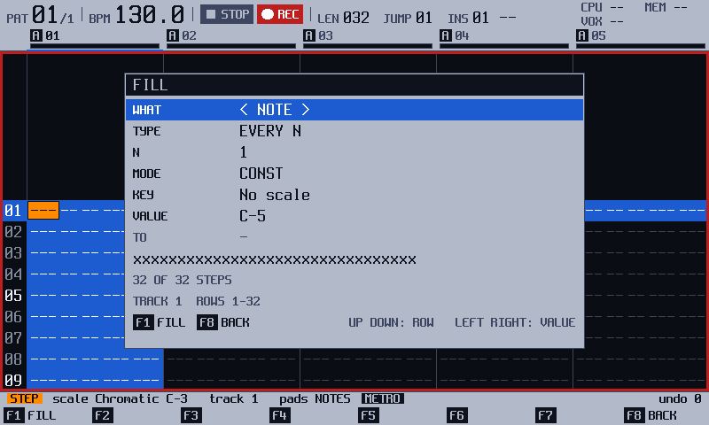
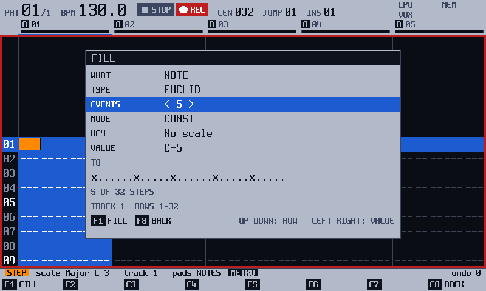
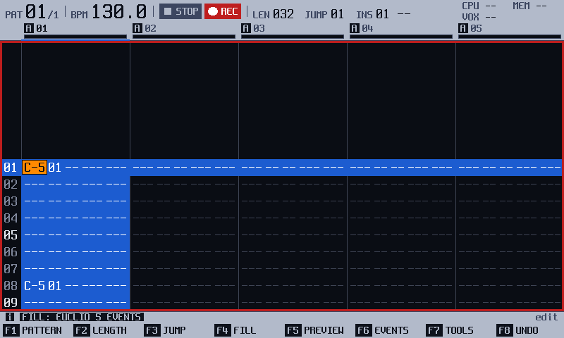
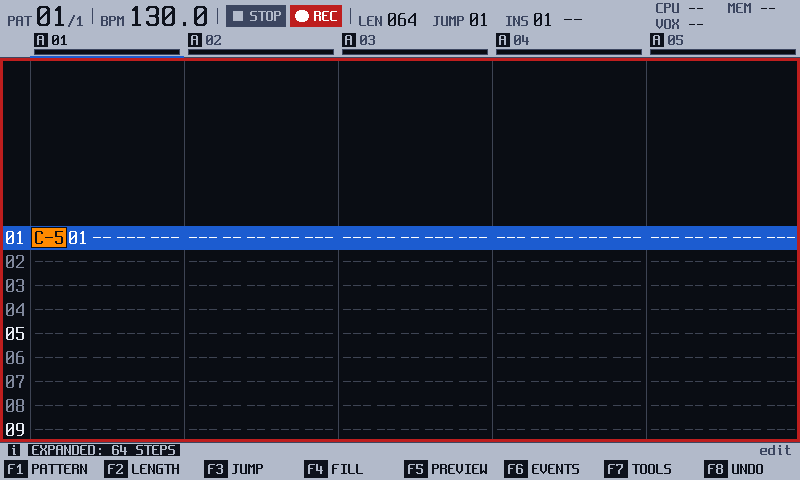
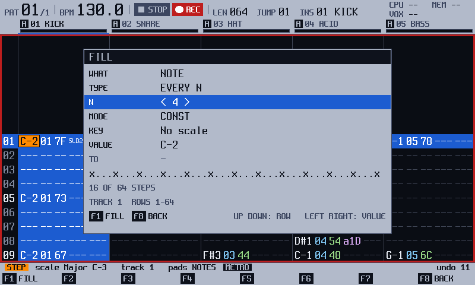
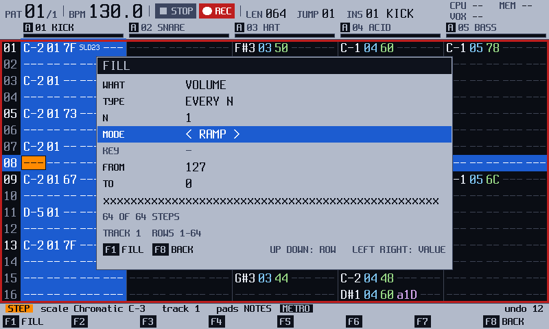

<!-- manual-sync: f5e29c02 -->
<!-- Sources: docs/qa/catalogue/pattern.md, QA-PAT-086..095 and 300..309 (Fill), QA-PAT-090 (Shift + Fx), QA-PAT-160..167, 210..213 and 280..289 (TOOLS, the length tools, the whole-pattern copy). Export entries (QA-PAT-180, 185..189) are in export.md. -->
<!-- Open rows, not written: none in these ranges. The IDs 030 to 049 of the Pattern catalogue are not in the catalogue. -->
# Fill and tools

Status: draft

These tools write a stretch of the pattern by a rule, where you would otherwise enter one step at a time. **FILL** (`F4`) writes notes, instruments, volumes or an effect on every Nth step, on a Euclid rhythm, on random steps or along a scale, with one value, along a ramp or at random. The verb menu (`F7`) opens in the right-hand panel beside the grid (the right 300 px of the screen, `x 500..800`; while it is up the grid is drawn in the 500 px left of it — three tracks at the 5-track zoom — and scrolls so the block's first track stays in view) and picks a tool by pad — **INTERPOLATE** (4), **RANDOMISE** (5), **HUMANISE** (6), **ROTATE UP / DOWN** (7 / 8), **INVERT** (9), **DUPLICATE x2**, **EXPAND x2** and **SHRINK /2** (pads 10-12), and **APPS >** (pad 16) opens the list of the apps on the card that edit the project; hold `F7` and press a pad to run that verb without opening the menu. Holding `F1` with `Copy` copies one whole pattern onto another. The official firmware has a Fill dialog, duplicate, expand and shrink, and a whole-pattern copy too; here they work as this chapter says. <!-- og: different --> The apps in the TOOLS list are new in track3r-os. <!-- og: new -->

## What it is for

Use FILL to lay down a rhythm, a fade or a run of random notes in one go, then play with the result. Use TOOLS to change a pattern's length or to run an app on it. Both are on the [Pattern](pattern.md) screen, in STEP, with the transport stopped for the APPS page.

## How it works
<!-- sync: src=app/src/fill_actions.cpp,app/src/fill_view.cpp,app/src/tools_actions.cpp,app/src/pattern_ops_actions.cpp spec=docs/specs/OS-FILL2.md,docs/specs/OS-PTOOLS.md,docs/specs/OS-MIDIREC.md qa=QA-PAT-086,QA-PAT-088,QA-PAT-089,QA-PAT-160,QA-PAT-162,QA-PAT-166,QA-PAT-280,QA-PAT-285,QA-PAT-400,QA-PAT-401,QA-PAT-461 -->

### What is a fill?

A fill is a rule plus a value. The rule picks which steps get something, and the value says what they get. It is like stamping a pattern of dots on a strip of paper, then choosing the colour of the ink.

The dialog is live, and it writes nothing. A line of steps under the rows shows the hits as **x**, with a count such as `4 OF 8 STEPS`, and the footer under it names the target (`TRACK 1  ROWS 1-64` here). Nothing reaches the pattern until you press `F1` (**FILL**). Then the notes are stored in the pattern like any note, and the whole fill is one undo step. `F8` (**BACK**) leaves the dialog and ends it with no change. <!-- QA-PAT-086, QA-PAT-088, QA-PAT-089 -->

An example: choose EUCLID with 5 events and press `F1`. Five notes land spread as evenly as the track's steps allow, a rhythm you would not tap by hand. Press `F8` (**UNDO**) and the track is as it was.

### What are the rules and the values?

The **TYPE** row is the rule: <!-- QA-PAT-094, QA-PAT-305 -->

| TYPE | What it picks |
|---|---|
| EVERY N | Steps 1, N+1, and so on. |
| EUCLID | Exactly E hits, spread evenly. The gaps differ by at most one. If E is more than the steps, every step is filled. |
| RANDOM | **DENSITY** 0 picks none, 100 picks all, 30 picks about three in ten. |
| SCALE | The notes of the scale from FROM to TO, going up, then repeating. No note twice in a row. Never above note 127. |

The **MODE** row is the value. **CONST** writes one value (FROM). **RAMP** goes from FROM to TO over the hits, so a volume ramp from 127 to 0 is a fade-out. **RANDOM** picks a value from FROM to TO for each hit. **WHAT** chooses what is written: a note, an instrument, a volume, or the effect in **FX 1** or **FX 2**. Where the fill goes is the selection, and the footer of the dialog says it: a block, the whole track (**`Shift` + `Up`** on step 1), the whole pattern (again), or the cursor step alone. Each track counts its own steps, so its first step gets FROM and its last gets TO. <!-- QA-PAT-301, QA-PAT-306, QA-PAT-086, QA-PAT-091 -->

The dialog keeps its rows until you switch the unit off, FROM included: reopen it and it reads what you left (the first time after switching on, FROM is the step under the cursor). Changing WHAT starts FROM and TO again. When the fill draws at random (TYPE RANDOM, or MODE RANDOM), `F2` (**VARY**) takes back the fill you just made and draws again, as long as you have not edited that pattern since; the dialog stays up, so `F2` again re-rolls. <!-- QA-PAT-450, QA-PAT-451 -->

### What are the tools?

The TOOLS menu is the verb menu that `F7` opens. Its pads hold the length tools, **DUPLICATE x2** (pad 10), **EXPAND x2** (pad 11) and **SHRINK /2** (pad 12), which change a pattern's length in one press, and the two exports, on [Export](export.md). On the Pattern key row `F6` (**EVENTS**) lists the pattern's MIDI events, the track under the cursor or the selected block, as rows in time order (see [See a track as MIDI events](#see-a-track-as-midi-events)). The last pad, **APPS >** (pad 16), opens the APPS page, which lists the tool apps on the card and nothing else. The tool apps, such as RHYTHM GEN, are small programs that write into the pattern. The page opens on the first app. EVENTS opens while the transport plays in WATCH and STEP; in LIVE the playhead holds the cursor and the strip says **THE PLAYHEAD HOLDS THE CURSOR IN LIVE**. <!-- QA-PAT-160, QA-PAT-180, QA-PAT-400, QA-PAT-401, QA-PAT-448, QA-PAT-449 -->

A tool is stored when you run it: it edits the pattern at once, and one `F8` (**UNDO**) takes back the whole change. An app that only edits the pattern starts at once, with no question. Leave an app with `F7` and `F8` together. <!-- QA-PAT-162, QA-PAT-165, QA-PAT-166 --> For example, EXPAND x2 on a short pattern makes one twice as long, at half speed, with a gap between every note, ready to fill the gaps by hand.

HUMANIZE, the one small tool app on the panel's list, opens in the same right-hand panel as the TOOLS dialog, beside the grid. The panel lists the app's own rows (TIME, VOL and SEED), with the one you are on between `<` and `>`; `Up` and `Down` choose the row, the encoder changes the value (`Shift` for a bigger step), and a footer names what the app works on: the selected block, or the step under the cursor. `F1` (**APPLY**) runs the app on that block in one undo step, with no question, and the app's answer (what it did, or why it did nothing) shows under the footer. The block is the target, so this app has no target rows. Every other app keeps its own page: MUTATE and MORPH (with their INSTRUMENT row), CHORDS and RHYTHM GEN (with the target rows), TAP CALC and SMF EXPORT. `F8` or `F7` and `F8` together close the panel and return to the pattern with the block as it was. <!-- QA-PAT-461, QA-PAT-464 -->

### The block's hint on the info line

In Edit, with a block selected, the info line says what it is and what the keys do to it: **BLOCK 16 STEPS  ENC: TRANSPOSE  F7: TOOLS  PAD: SET  DEL: CLEAR** (the parts that do not fit are left off, from the end; outside Edit — in WATCH — the line shows no hint, since the encoder, the pads and `Del` all need Edit). The encoder acts on the column under the cursor (TRANSPOSE on Note, INSTRUMENT, VOLUME, FX VALUE), and with `Shift` held on Note it reads **OCTAVE**; on an FX column the FX reading is still drawn after the hint; the verb menu (`F7`) holds TRANSPOSE and INSTRUMENT as dialog verbs (see [The TOOLS dialog over a block](#the-tools-dialog-over-a-block)). <!-- QA-PAT-447, QA-PAT-449 -->

### The TOOLS dialog over a block
<!-- sync: src=app/src/pattern_tools_actions.cpp,app/src/pattern_tools_view.cpp,app/src/screens/pattern_tools_overlay.cpp spec=docs/specs/OS-PTOOLS2.md qa=QA-PAT-457,QA-PAT-458,QA-PAT-459 -->

The verb menu's **TRANSPOSE** (pad 1) and **INSTRUMENT** (pad 2) rows open the TOOLS dialog in the same right-hand panel, beside the grid instead of over it: the grid narrows to the 500 px left of the panel (three tracks at the 5-track zoom) and scrolls so the block's first track is the leftmost column, so the block stays visible while you choose (instead of running one step of the encoder's verb). It has the same shape as the Song screen's TOOLS dialog: an **OP** row (`Left` / `Right` flips TRANSPOSE, INSTRUMENT and CLEAR), the OP's value row — **AMOUNT** in semitones from -24 to +24 for TRANSPOSE (`Shift` + the encoder moves an octave, 12 st, a turn), **TO** the instrument 1..64 for INSTRUMENT, **WHAT** (NOTES, VOLUME, FX 1, FX 2, ALL) for CLEAR — and a footer that names the target (**BLOCK  TRACK 1  NOTE  ROWS 01-03**, or **STEP  TRACK 1  ROW 01** with no selection) and counts it (**3 STEPS  3 NOTES**). The rows keep their values while the unit is on.

`F1` (**APPLY**) runs the tool over the block as one undo step: TRANSPOSE moves every note of the block by AMOUNT (cut, fade and off steps, and empty steps, are untouched) and the strip says **TRANSPOSED: 3 STEPS +12 ST**; the lane notes of a whole-step block move by the same amount (see [Pattern](pattern.md)); INSTRUMENT sets every note to TO and says **INSTRUMENT SET: 3 STEPS 05**; CLEAR clears WHAT and says **CLEARED: N STEPS**; with WHAT on ALL and the block covering the whole cursor track, it also clears that track's MIDI lane (the strip adds **+ LANE**), in the same undo step. Over several tracks the block clears the steps of all of them, but only the cursor track's lane. `F8` (**BACK**) leaves the dialog with nothing written. `F6` (**REPEAT**) repeats the last APPLY with the same amount, on the selection as it is now, as one undo step; after a fill, `F6` (**RE FILL**) repeats the fill. A block of only some columns takes TRANSPOSE on the Note column and INSTRUMENT on the Instr column; on any other column the strip says why (for example **TRANSPOSE: WHOLE STEPS OR THE NOTE COLUMN**) and no dialog opens, and CLEAR on such a block is refused with **CLEAR: WHOLE STEPS ONLY**, since it clears whole steps. <!-- QA-PAT-457, QA-PAT-458, QA-PAT-459 -->

## Try it
<!-- sync: src=app/src/fill_actions.cpp,app/src/fill_view.cpp,app/src/tools_actions.cpp,app/src/pattern_ops_actions.cpp qa=QA-PAT-086,QA-PAT-087,QA-PAT-088,QA-PAT-160,QA-PAT-280,QA-PAT-246 -->

1. Press `Pattern`, then `Rec`. The chip reads **STEP**.
2. Hold `Shift` and press `Up` on step 1: the whole track is selected. Press `F4` (**FILL**). The Fill dialog opens, and its footer says where the fill goes: `TRACK 1  ROWS 1-64`. <!-- QA-PAT-086 -->

   

3. Press `Down` once and `Right` twice, so TYPE reads **EUCLID**. Press `Down` and `Right` once more, so EVENTS reads 5. The line shows five hits. <!-- QA-PAT-087 -->

   

4. Press `F1` (**FILL**). Five notes are written, spread down the track, and the strip says **FILL: EUCLID 5 EVENTS**. The screen shows the first steps only, so you see the first two, on steps 1 and 8. <!-- QA-PAT-088 -->

   

5. Press `F7` (**TOOLS**). The verb menu opens, with the length tools **DUPLICATE x2**, **EXPAND x2** and **SHRINK /2** on pads 10 to 12. <!-- QA-PAT-436 -->
6. Press pad 11 (**EXPAND x2**). The track is twice as long, and the strip says **EXPANDED: 64 STEPS**. Each note sits twice as far from step 1, so step 8 is empty now. <!-- QA-PAT-280 -->

   

7. Press `F8` (**UNDO**). The length comes back, and `Play` gives you the five-note rhythm again. <!-- QA-PAT-246 -->

## The screen at a glance

| Row | What it sets |
|---|---|
| WHAT | **NOTE**, **INSTR**, **VOLUME**, **FX 1** or **FX 2**: what the fill writes. |
| TYPE | **EVERY N**, **RANDOM**, **EUCLID** or **SCALE**: the rule. |
| N | The step count for EVERY N and SCALE. It reads **EVENTS** for EUCLID, and **DENSITY** for RANDOM: how many steps get a value, from 0 to 100. |
| MODE | **CONST**, **RAMP** or **RANDOM**: the value. |
| KEY | For NOTE: the scale and its root in one row, such as `C# Dorian`. For FX 1 and FX 2 it reads **FX TYPE**: the effect to write. |
| FROM, TO | The value, or the two ends of the ramp or the range. FROM reads **VALUE** in CONST, where TO is dim. |

The rows that do not apply are dim. MODE is dim for NOTE with RANDOM or SCALE: those two rules choose the notes, and FROM and TO then set the window of notes they choose from. KEY is dim for INSTR and VOLUME. There is no SCOPE row: the selection is the target, and the footer under the rows names it — `BLOCK  TRACK 3  ROWS 1-16` for a block, `TRACK 3  ROWS 1-64` for the whole track of `Shift` + `Up` on step 1, `PATTERN  ALL TRACKS  ROWS 1-64` for the whole pattern, `STEP  TRACK 3  ROW 5` for the cursor step alone. The dialog opens with FROM and TO taken from the cursor step: the note under it and an octave above, the instrument in hand, its volume (else 127) down to 0, or its FX type. The key row reads **FILL** on `F1` and **BACK** on `F8`. <!-- QA-PAT-300, QA-PAT-305, QA-PAT-308, QA-PAT-309, QA-PAT-091 -->

## More tasks

### Fill a track with a rule

Start on the Pattern screen, in **STEP**. Hold `Shift` and press `Up` on step 1 to select the whole track (the footer of the dialog will read `TRACK 1  ROWS 1-64`).

1. Press `F4` (**FILL**). <!-- QA-PAT-086 -->
2. Press `Down` to a row, then `Right` to change it. Set TYPE to the rule. <!-- QA-PAT-087 -->
3. Set N, DENSITY or EVENTS. For a note fill, set KEY to a scale: `Right` steps the scale, `Shift` + encoder steps the root. <!-- QA-PAT-094, QA-PAT-304 -->
4. Press `F1` (**FILL**). <!-- QA-PAT-088 -->

You should see the notes on the steps the rule picks. In WATCH the strip says **FILL: TURN EDIT ON**. <!-- QA-PAT-093 -->

### Fade a track out with a ramp

Start on the Pattern screen, in **STEP**, with the track selected (`Shift` + `Up` on step 1).

1. Press `F4` (**FILL**). Set WHAT to **VOLUME** and MODE to **RAMP**. FROM reads 127 and TO reads 0. <!-- QA-PAT-300 -->

   

2. Set TYPE to **EVERY N** and N to 1.
3. Press `F1` (**FILL**). <!-- QA-PAT-301 -->

You should see the volume column fall from 7F to 00 over the track, and the strip says **FILL: EVERY 1 STEP, VOLUME RAMP 127-0**. Set FROM below TO to fade in. RAMP on a note moves it up into the scale of KEY, and RANDOM picks a note of that scale between FROM and TO, never the same one twice in a row. A note that cannot be placed at 127 or below leaves its step as it was. <!-- QA-PAT-301, QA-PAT-306 -->

### Fill an effect column

Start on the Pattern screen, in **STEP**, with the track selected (`Shift` + `Up` on step 1).

1. Press `F4` (**FILL**). Set WHAT to **FX 1** or **FX 2**.
2. Set FX TYPE (the row under MODE) to the effect, such as **Chance**. FROM and TO go to that effect's default value. <!-- QA-PAT-302 -->
3. Set MODE, then FROM and TO. A value stays inside the range of the effect.
4. Press `F1` (**FILL**). <!-- QA-PAT-303 -->

You should see the effect and a value on every step the rule picks, such as **FILL: EVERY 1 STEP, FX 1 RANDOM 0-100**. A step that held another effect in that column gets the new one. The note, instrument, volume and the other FX column stay. <!-- QA-PAT-303, QA-PAT-307 --> If the cursor step has no effect in that column, FX TYPE starts on **Off**, and `F1` writes **Off** over the hits. One `F8` takes it back. <!-- QA-PAT-309 -->

### Fill only a block

Start on the Pattern screen, in **STEP**. Put the cursor on the first step of the block.

1. Hold `Shift` and press `Down` seven times. This selects eight steps. Started on one column, the block covers that column only. <!-- QA-PAT-091, QA-PAT-007 -->
2. Press `F4` (**FILL**). The footer reads **BLOCK  TRACK 1  ROWS 1-8**. <!-- QA-PAT-091 -->
3. Set TYPE to **EVERY N**, and N to 2. The line reads `x.x.x.x.` and the count reads `4 OF 8 STEPS`. <!-- QA-PAT-091 -->
4. Press `F1` (**FILL**). Steps 1, 3, 5 and 7 of the block get the note. Nothing outside the block changes. <!-- QA-PAT-092 --> A block that holds only some columns fills whole steps, and the strip begins **FILL: WHOLE STEPS**. <!-- QA-PAT-092, QA-PAT-321 -->

### Run a tool app

Start on the Pattern screen, with the transport stopped.

1. Press `F7` (**TOOLS**), then pad 16 (**APPS >**). The APPS page opens, with the tool apps only. <!-- QA-PAT-436, QA-PAT-160 -->
2. Press `Down` to the app, for example **RHYTHMGEN**. <!-- QA-PAT-210 -->
3. Press `F1` (**RUN**). An app that only edits the project starts at once, with no question. <!-- QA-PAT-162, QA-PAT-276 -->
4. Work in the app, then press `F7` and `F8` together. You are back on the Pattern screen. <!-- QA-PAT-165 -->

An app opens on the block you selected. It gets whole steps: a block of only some columns reaches it as the whole steps of its rows and tracks. <!-- QA-PAT-163, OS-AUDIT-56 in app/src/tools_actions.cpp --> `F8` (**BACK**) closes the page without running anything. <!-- QA-PAT-276 -->

You should see the app's notes on the Pattern screen. One `F8` (**UNDO**) takes back everything the app wrote, and the strip says `UNDO RHYTHM GEN`. <!-- QA-PAT-166 --> The list shows the apps on the card that edit the project, sorted by name: <!-- QA-PAT-160 -->

| App | What the catalogue says |
|---|---|
| RHYTHM GEN | Works on the block, or on 16 rows from the cursor when no block is selected. Its last page (`Right` to SHARED) ends with the rows PATTERN, TRACK, ROW and ROWS, so you can move the target without leaving the app. `Delete` puts a row back to where you opened it. The rows are not remembered. <!-- QA-PAT-163, QA-PAT-164, QA-MOD-132 --> |
| HUMANIZE | Moves notes a little late, and makes their volume a little louder or softer, with a Micro-move in an FX column. The rows below SEED are its target: it starts at the block or the cursor. <!-- QA-PAT-211, QA-MOD-132 --> |
| CHORDS | On a MIDI track, writes root notes with a Chord effect. On a sample in spread mode, puts the chord's tones on three tracks. `Right` opens a second page with the target. <!-- QA-PAT-212, QA-MOD-132 --> |
| MORPH, MUTATE | Work on a whole instrument; see [Modules](modules.md#launch-an-app-on-the-pattern-you-are-editing). `F1` (**APPLY**) writes the change as one undo unit, and `F8` takes it back. MUTATE also has `F2` (**VARY**), which takes the next seed and applies it. MORPH has `F3` (**RESET**), which puts the instrument back as it was when the page opened. <!-- QA-MOD-071, QA-MOD-086, QA-MOD-088, QA-PAT-166 --> |
| TAPCALC | Measures a tempo from your taps. See [Modules](modules.md). <!-- QA-MOD-003 --> |

### See a track as MIDI events
<!-- sync: src=app/src/events_actions.cpp,app/src/screens/events_overlay.cpp spec=docs/specs/OS-MIDIREC.md qa=QA-PAT-400,QA-PAT-401,QA-PAT-402,QA-PAT-403,QA-PAT-404,QA-PAT-405,QA-PAT-406,QA-PAT-407,QA-PAT-408,QA-PAT-409,QA-PAT-410,QA-PAT-412,QA-PAT-413,QA-PAT-414,QA-PAT-415,QA-PAT-416,QA-PAT-417,QA-PAT-418,QA-PAT-419,QA-PAT-420,QA-PAT-424 -->

Start on the Pattern screen, with the transport stopped. Select a block first to list its tracks and rows instead of the cursor's track.

1. Press `F6` (**EVENTS**). The grid pane becomes the event list. <!-- QA-PAT-436, QA-PAT-400, QA-PAT-401 -->
2. One row per note, with its length in **LEN**; one per MIDI CC (`CC A` to `CC F`); one per note-off that ends no note above it. `Up` and `Down` move the row; `Left` and `Right` move across its fields. <!-- QA-PAT-402 -->
3. In Edit (`Rec`), the encoder changes the boxed field of the row — TIME by a microstep (a whole step with `Shift`), DATA by a semitone, VAL by 1, LEN by a step, TYPE to the next CC letter, CH to the next channel, IN to the next instrument — and a pad enters the pad's note on **DATA**, the 0..127 ramp on **VAL**, or sounds the row's step anywhere else. Each press writes the step and is one undo step. <!-- QA-PAT-412..420 -->
4. The columns read TIME (the step and the percent of it, so a micro-moved note reads `009.50`), CH, DATA (the note, or what the CC sends, such as `#074`, `PROG` or `--`), VAL, IN and FL. A note with nothing below it reads `>` in LEN and plays on past the track's end. A row of a take lane has an `L` in the SRC column (see "Edit the events of a take lane" below). <!-- QA-PAT-402, QA-PAT-403, QA-PAT-404, QA-PAT-405 -->
5. Press `F1` (**FILTER**) to show every row, only the notes, or only the CC rows: the key reads `ALL 1/3`, `NOTE 2/3`, `CC 3/3`, and the count in the header follows. <!-- QA-PAT-407 -->
6. Hold `F5` (**PREVIEW**) to hear the row's step. While the pattern plays, a bar in the left margin marks the row of the step that is playing. <!-- QA-PAT-410 -->
7. Press `F8` (**BACK**): the grid cursor lands on the row's step, track and column. <!-- QA-PAT-408 -->

In WATCH the list is read-only and an edit key says **TURN EDIT ON**, writing nothing. An effect on the row's step that the row does not show, such as a chord, is named on the info line (`ALSO: CHORD 57B` for a Chord 47), and a gated note shows `G` with its gated length. <!-- QA-PAT-406 --> The event list refuses to open while the view follows the playhead (the strip says **STOP PLAYING TO OPEN EVENTS**), with no project (**NO PROJECT**), on a pattern the project does not have (**PATTERN IS EMPTY**); an empty scope opens an empty list (**NO EVENTS: INSERT ADDS ONE**), and an edit key on it says the same. <!-- QA-PAT-409, QA-PAT-424 --> New in track3r-os. <!-- QA-PAT-400..420, QA-PAT-424 -->

### Add, delete and tidy events
<!-- sync: src=app/src/events_actions.cpp,model/src/event_list.cpp spec=docs/specs/OS-MIDIREC.md qa=QA-PAT-421,QA-PAT-422,QA-PAT-423,QA-PAT-424,QA-PAT-425,QA-PAT-426,QA-PAT-427,QA-PAT-428 -->

Start in the event list with Edit on (`Rec`). The list shows the steps of the pattern, so every key here writes ordinary steps: the grid, the file and the MIDI out see nothing new. A step holds one note and two FX columns, so a few moves are refused, and the strip says why.

1. Press `Insert` on a note row. A copy of the note (note, instrument, volume) lands on the step where the note ends, and the cursor goes to the new row. <!-- QA-PAT-421 -->
   If the next step holds a note, or nothing ends the note, the strip says **NO FREE STEP AFTER THIS NOTE** and nothing is written.
2. Press `Insert` on a CC row. The same CC letter and value land on the next step that has a free FX column. <!-- QA-PAT-421 -->
3. Press `Shift` + `Insert` to add the other kind on the row's step: a `CC A 000` on a note row, a note on a CC row whose step has no note. On an empty list `Insert` adds a note and `Shift` + `Insert` a `CC A`, on the first step of the track. <!-- QA-PAT-421 -->
4. Press `Delete` to clear the row. A note row clears its note, its volume and its end. A CC row clears its FX column only. If the deleted note ended the note above it, an OFF takes its place, so that note keeps its length. <!-- QA-PAT-422 -->
5. Press `F2` (**QUANT**) on a note row. A note up to 23 microsteps (47% of a step) late goes back to `.00`. A note later than that moves on to the next step at `.00`, with its end. The strip says why when the next step holds a note (**STEP 010 HOLDS A NOTE**). A CC row says **CC IS ON THE STEP**, because a CC has no time inside a step. <!-- QA-PAT-426, QA-PAT-428 -->
6. Press `Shift` + `F2` (**QUANT ALL**) to do the same for every note and OFF row the filter shows, as one undo step. The strip says **QUANTISED 12**, or **QUANTISED 12, 2 LEFT (STEP TAKEN)** when two rows could not move. A run of late notes all move: the pass repeats while it frees steps. <!-- QA-PAT-427 -->
7. Press `F7` (**UNDO**) to take back the last edit without leaving the list, and `Shift` + `F7` (**REDO**) to do it again. The list shows the pattern again and the cursor stays on its event. `F8` (**UNDO**) on the grid takes back the same steps after you press `F8` (**BACK**). <!-- QA-PAT-423 -->

In WATCH every one of these keys says **TURN EDIT ON** and writes nothing. <!-- QA-PAT-424 --> Each key is one undo step, and **QUANT ALL** is one for the whole operation. A CC step with a micro-moved note still sends its CC at the start of the step, and only the note is late: that is why a CC row has no time inside a step. <!-- QA-PAT-425 --> New in track3r-os. <!-- QA-PAT-421..423, QA-PAT-426..428 -->

### Edit the events of a take lane
<!-- sync: src=app/src/events_actions.cpp,app/src/screens/events_overlay.cpp,model/src/event_list.cpp spec=docs/specs/OS-MIDIREC-P1.md qa=QA-PAT-505,QA-PAT-506,QA-PAT-507,QA-PAT-508,QA-PAT-509,QA-PAT-510,QA-PAT-511,QA-PAT-512 -->

A track can hold a lane of MIDI events beside its steps: a take that was recorded with REC STORE set to Lane keeps every note, CC and bend at its own time, on the channel it came in on. The event list shows them after the steps' rows at the same time, in time order, and a lane row has an **L** in the **SRC** column. A step row has nothing there. <!-- QA-PAT-505 -->

Start in the event list with Edit on (`Rec`), on a track that has a lane.

1. Look at the list. Notes that sound together, such as a chord, are several NOTE rows with the same TIME. **CH** is the channel the event is stored with, and **LEN** of a note is its true length, not a number of steps. <!-- QA-PAT-505 -->
2. Press `Right`. A lane row has no TYPE, IN or FX field, so `Right` goes from TIME to CH, then DATA, VAL and LEN. The encoder changes the boxed field: CH by one channel, LEN by its own unit, TIME by one tick (a whole step with `Shift`). Each detent is one undo step. <!-- QA-PAT-506, QA-PAT-507 -->
3. After a TIME change the row takes its new place in the list and the cursor follows it. TIME beyond the track's last step is refused: the strip says **OUTSIDE THE SCOPE**. <!-- QA-PAT-508, QA-PAT-512 -->
4. Press `Delete` to drop the event. A chord keeps its other notes. `F7` (**UNDO**) brings the event back. <!-- QA-PAT-509 -->
5. Press `Insert` on a lane note to add a copy where the note ends (`Shift` + `Insert`: at the same time). The strip says **NO ROOM AFTER THIS NOTE** when it cannot, and **TOO MANY EVENTS HERE** when more than 32 events would be touched at once. **LANE FULL: NOTHING CHANGED** means the lane has no room for the event. <!-- QA-PAT-510 -->
6. `F2` (**QUANT**) says **NO QUANT ON A LANE ROW** and writes nothing; `Shift` + `F2` leaves the lane rows as they are. <!-- QA-PAT-511 -->

`F5` (**PREVIEW**) has no step to sound on a lane row and says so. New in track3r-os.

### Double, spread or halve a pattern

Start on the Pattern screen, with the transport stopped and Edit on (`Rec`).

1. Press `F7` (**TOOLS**). The verb menu opens with **DUPLICATE x2** (pad 10), **EXPAND x2** (pad 11) and **SHRINK /2** (pad 12). <!-- QA-PAT-436 -->
2. Press the pad of the tool you want.
3. The menu closes and the tool runs. With a block selected, the tool changes the tracks of the block. With none, it changes every track.

You should see the new length of the longest track in the strip, for example **EXPANDED: 64 STEPS**. Each track goes by its own length. <!-- QA-PAT-280 --> A block of only some columns counts as whole steps, and the strip ends **WHOLE STEPS**. <!-- QA-PAT-321 -->

| Tool | What it does |
|---|---|
| **DUPLICATE x2** | Doubles the length and repeats the steps. A 32-step track becomes 64, and steps 33 to 64 copy steps 1 to 32. <!-- QA-PAT-284 --> |
| **EXPAND x2** | Doubles the length and puts each step on every second row, with an empty step between. The pattern plays at half speed. <!-- QA-PAT-280 --> |
| **SHRINK /2** | Halves the length, rounding an odd length up, and keeps every second step. The pattern plays twice as fast. EXPAND then SHRINK gives the pattern back. <!-- QA-PAT-282 --> |

A result over 128 steps is refused: the strip says **TOO LONG: 128 STEPS AT MOST** and nothing changes. <!-- QA-PAT-281 --> In WATCH the strip says **TURN EDIT ON**. <!-- QA-PAT-283 --> Effects that count ticks, such as retrigger and arpeggio, keep their values: the notes move, but the ticks inside a step do not scale. <!-- QA-PAT-280 -->

### Copy a whole pattern onto another

Start on the Pattern screen, with Edit on.

1. Hold `F1`. The strip shows **PATTERN**, and now also **COPY: COPY** and **SHIFT+COPY: PASTE**. <!-- QA-PAT-285 -->
2. Pick the pattern to copy with a pad (pads 1 to 48 are patterns 1 to 48), the encoder, `Up` or `Down`. `Left` and `Right` jump to the previous and the next pattern the project has. Press `Copy`. <!-- QA-PAT-256, QA-PAT-311 -->
3. Pick the pattern to write over. A pattern the project does not have yet is made.
4. Press `Shift` + `Copy`, then let go of `F1`. <!-- QA-PAT-286 -->

You should see **PATTERN 07 REPLACED BY 05**. The target now has the steps, the length of every track and the name of the copy. One `F8` (**UNDO**) takes it all back, and removes a pattern that the paste made. <!-- QA-PAT-287 --> `Copy` works in every mode. The paste needs Edit, and says **TURN EDIT ON** without it. In the grid, `Shift` + `Copy` pastes a whole-pattern copy as a block, steps only, at the cursor and clipped at each track's end. The target keeps its lengths and its name. <!-- QA-PAT-288 --> You may paste over the pattern that plays: each track takes its new length from its next row, but the pass in progress ends at the old pattern length. <!-- QA-PAT-289 --> A MIDI note that sounds on a track the paste leaves empty may stay on until the transport stops (`Play`).

At the first or last pattern, `Left` or `Right` says **NO PREVIOUS PATTERN** or **NO NEXT PATTERN** and changes nothing. While the transport plays, a pick also switches the playing pattern, as a pad pick does; with PAT SWITCH set to Pattern end it waits for the pattern's end. New in track3r-os. <!-- QA-PAT-311, QA-PAT-318 -->

## Keys on this screen

| Key | What it does | Ref |
|---|---|---|
| `F4` (**FILL**) | Opens the Fill dialog in STEP. | QA-PAT-086, QA-PAT-093 |
| `Up`, `Down` | Choose a row in the Fill dialog. | QA-PAT-087 |
| `Right`, encoder | Change the value of the row. | QA-PAT-087, QA-PAT-253 |
| `Shift` + encoder | N moves four a turn. DENSITY moves ten a turn. FROM and TO move twelve for a note and ten for the rest. On KEY it steps the root. | QA-PAT-253, QA-PAT-308 |
| `F1` (**FILL**) | Fills the selection: the block, the track or the pattern selected with `Shift` + `Up` on step 1, or the cursor step alone. | QA-PAT-088, QA-PAT-092 |
| `F2` (**VARY**) | Live while the fill draws at random (TYPE RANDOM, or MODE RANDOM): takes back the fill just made and draws again; the dialog stays up. | QA-PAT-451 |
| `F8` (**BACK**) | Leaves the Fill dialog without a fill. | QA-PAT-086 |
| `F7` (**TOOLS**) | Opens the verb menu in the right-hand panel beside the grid (pads 1-16 pick a verb, `F1` RUN, `F8` BACK); `F6` (**RE FILL**, **REPEAT** after an APPLY) repeats the last apply; **APPS >** (pad 16) turns the panel into the APPS page, the tool apps only. Held + a pad 1-16 runs that verb without opening the menu. It opens in STEP and WATCH while playing; refused only in LIVE (the strip says THE PLAYHEAD HOLDS THE CURSOR IN LIVE). | QA-PAT-436, QA-PAT-456, QA-PAT-160, QA-PAT-161, QA-PAT-448, QA-PAT-449 |
| `F7`, pad 1 / pad 2 | Opens the TOOLS dialog in the right-hand panel beside the block on TRANSPOSE / INSTRUMENT: the OP row, the AMOUNT / TO row, the footer with the target and the count. | QA-PAT-457, QA-PAT-459 |
| `Up`, `Down` | Choose a row in the TOOLS dialog. | QA-PAT-457 |
| `Left`, `Right`, encoder | The row's value in the TOOLS dialog: the OP flips, AMOUNT moves a semitone, TO an instrument. In the HUMANIZE panel only the encoder changes the value. | QA-PAT-457, QA-PAT-461 |
| `Shift` + encoder | The row's coarse step in the TOOLS dialog: an octave on AMOUNT, 8 on TO. | QA-PAT-458 |
| `F1` (**APPLY**) | Runs the dialog's tool over the block as one undo step (`TRANSPOSED: 3 STEPS +12 ST`). | QA-PAT-458 |
| `F8` (**BACK**) | Leaves the TOOLS dialog with nothing written. | QA-PAT-457 |
| `F7` (**TOOLS**), `F6` (**RE FILL**, **REPEAT** after an APPLY) | Repeats the last APPLY of the TOOLS dialog with the same amount, on the selection as it is now; after a fill, the fill (the later of the two wins). | QA-PAT-459 |
| `Up`, `Down`, encoder | Choose a row on the APPS page. `Shift` + `Up` or `Down` moves a page of eight. | QA-PAT-160 |
| `F1` (**RUN**) | Runs the chosen item. | QA-PAT-160 |
| `F7` + `F8` | Leaves an app's page, back to the Pattern screen. | QA-PAT-165 |
| `Left`, `Right`, with `F1` held | Pick the previous or the next pattern the project has. | QA-PAT-311 |
| `F8` (**BACK**) | Closes the APPS page. | QA-PAT-276 |
| `Copy`, with `F1` held | Copies the pattern the chooser shows, whole. | QA-PAT-285 |
| `Shift` + `Copy`, with `F1` held | Writes the copy over the pattern the chooser shows. | QA-PAT-286 |
| `F8` (**UNDO**) | Takes back a fill, a tool, a whole-pattern paste, or everything an app wrote in one run. | QA-PAT-089, QA-PAT-166, QA-PAT-280, QA-PAT-287 |
| `F6` (**EVENTS**) | Opens the event list over the grid pane, on the cursor's track or the block. | QA-PAT-436, QA-PAT-400, QA-PAT-401, QA-PAT-409 |
| `Up`, `Down`, encoder | The row of the list; `Shift` + `Up` / `Down` a page. | QA-PAT-400 |
| `Left`, `Right` | The field of the row (TIME, TYPE, CH, DATA, VAL, LEN, IN). | QA-PAT-400 |
| `F1` (**FILTER**) | Shows every row, only the notes, or only the CC rows. | QA-PAT-407 |
| `F5` (**PREVIEW**), held | The row's step sounds. | - |
| `Insert`, `Shift` + `Insert` | Copy the row (a note onto its end step, a CC onto the next free step), or add the other kind on its step. | QA-PAT-421 |
| `Delete` | Clears the row; a note takes its end with it. | QA-PAT-422 |
| `F2` (**QUANT**) | Snaps the row to the step: under 24 microsteps back to `.00`, else on to the next step. | QA-PAT-426, QA-PAT-428 |
| `Shift` + `F2` (**QUANT ALL**) | Does the same for every note and OFF row the filter shows, as one undo step. | QA-PAT-427 |
| `F7` (**UNDO**), `Shift` + `F7` (**REDO**) | Take back or redo a list edit; the list stays open. | QA-PAT-423 |
| `F8` (**BACK**) | Closes the list; the grid cursor lands on the row's step, track and column. | QA-PAT-408 |

## Good to know
<!-- sync: src=app/src/tools_actions.cpp qa=QA-PAT-090,QA-PAT-095,QA-PAT-160,QA-PAT-161,QA-PAT-162 -->

- The TOOLS menu does not open in LIVE, where the playhead holds the cursor. The strip says **THE PLAYHEAD HOLDS THE CURSOR IN LIVE**. Leave LIVE (`Shift` + `Rec`), then press `F7`. In WATCH it opens, but the edit entries say **TURN EDIT ON**. The event list does not open while the view follows the playhead (**STOP PLAYING TO OPEN EVENTS**). <!-- QA-PAT-161, QA-PAT-409 -->
- `F8` undoes the Pattern area only. A song or Params edit stays, and when nothing is left the strip says **NOTHING TO UNDO HERE**. <!-- QA-PAT-246 -->
- With no tool app on the card, the APPS page says **NO TOOL APPS ON THE CARD**. The read-only apps, MIDI Monitor and Loudness VU, are not on the page; the Modules screen lists them. <!-- QA-PAT-160 -->
- An app that writes files (it has the export files capability) asks once on its first `F1` from the page, then starts at once until the unit restarts. An app that only edits the project never asks. <!-- QA-PAT-162 -->
- `Shift` + `Fx` no longer repeats a fill. It jumps to row 49 of a 64-step pattern. Use `F4`. <!-- QA-PAT-090 -->
- The scales named on screen include these four. <!-- QA-PAT-095 -->

| Scale | Steps above the root |
|---|---|
| Mel. minor | 0 2 3 5 7 9 11 |
| Blues major | 0 2 3 4 7 9 |
| Todi | 0 1 3 6 7 8 11 |
| Gypsy minor | 0 2 3 6 7 8 11 |

- The official firmware has a Fill dialog, duplicate, expand and shrink, and a whole-pattern copy. Here the Fill dialog has its own rules and value modes, and the length tools and the copy are reached from the TOOLS menu's pads and with `F1` held. <!-- og: different --> The APPS page of tool apps is new in track3r-os. <!-- og: new --> Not checked against the original firmware: the Euclid rule, the scale list, and what its length tools and whole-pattern copy do in every detail. <!-- og: open --> <!-- QA-PAT-086..095, QA-PAT-160..213 -->

## See also

- [Pattern](pattern.md): the record modes, the cursor and the block that a fill can use.
- [Effects in the pattern](fx.md): the effects that the FX rows of a fill can write.
- [Export](export.md): EXPORT PATTERN and EXPORT SELECTION, which are pads 14 and 15 of the TOOLS menu.
- [Modules and apps](modules.md): installing apps on the card.
