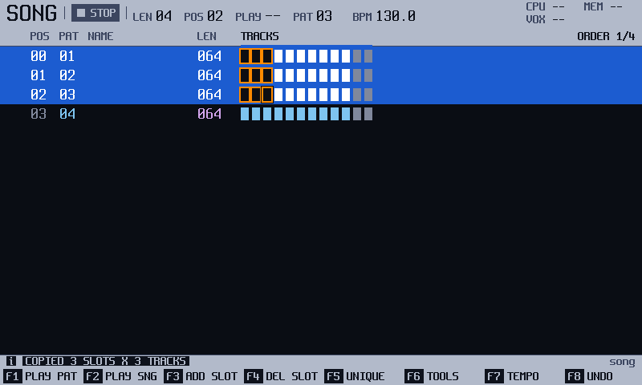
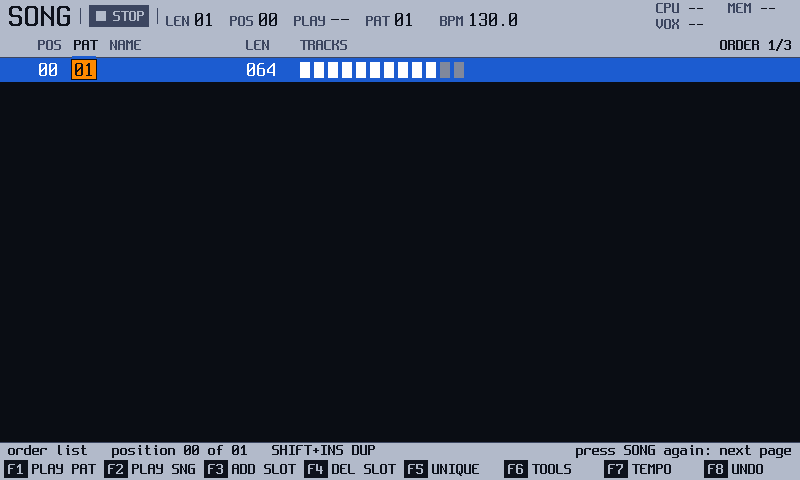
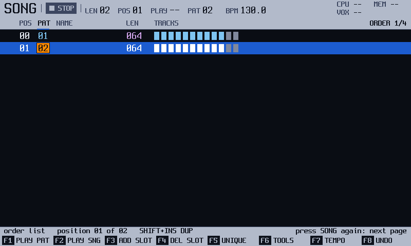
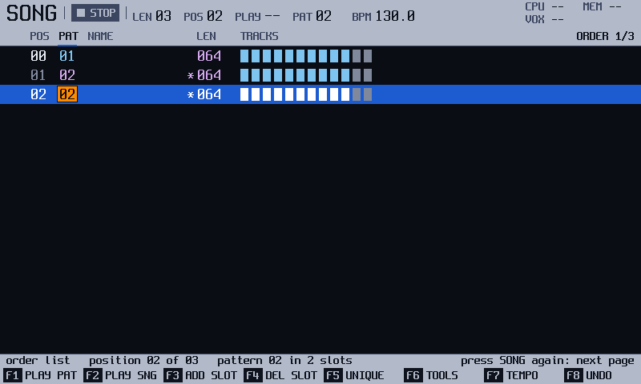
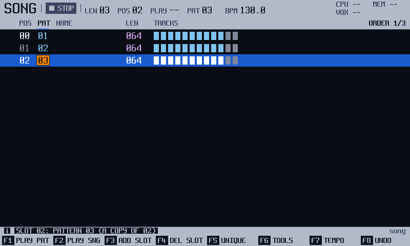
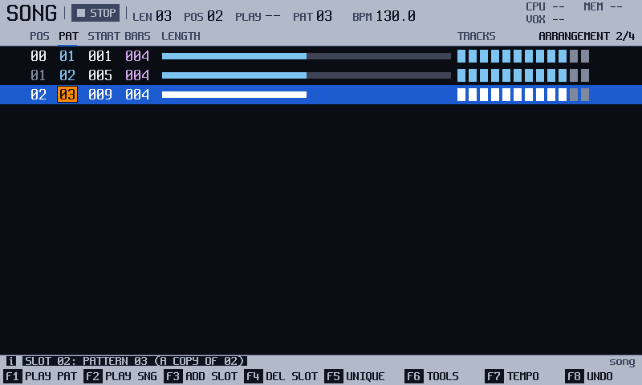
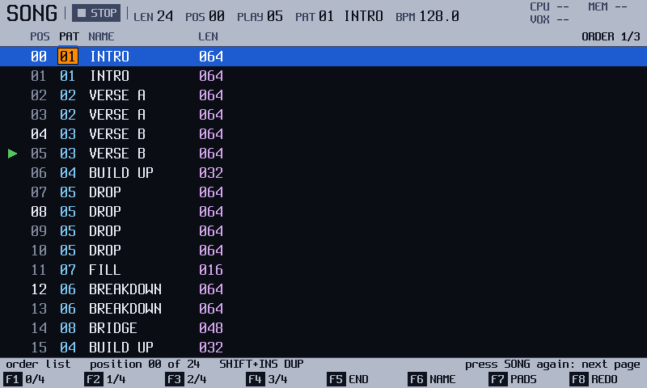

<!-- manual-sync: 3ba49bb7 -->
# Song
<!-- sync: src=app/src/screens/song_screen.cpp,app/src/song_actions.cpp,app/include/o3os/app/song_map.h spec=docs/specs/SONG-UX.md,docs/specs/OS-SONGSHARE.md qa=QA-SNG-020,QA-SNG-034,QA-SNG-036,QA-SNG-040,QA-SNG-050 -->

Status: draft

Song is an editor, not only a list. Adding a slot with `F3` (**ADD SLOT**) works as before, and the new slot shares the pattern of the one you were on. New in track3r-os: a `*` marks slots that share a pattern, and `F5` (**UNIQUE**) gives a slot a copy of its own. `Right` steps from the list into a map of slots and tracks that you can copy, paste, clear and transpose, and `F6` (**TOOLS**) opens the block tools. The pads can pick slots, and holding `Song` shows the screen for a moment. <!-- og: new -->

## What it is for

Use Song to arrange patterns in time. Press `Song`. The order list holds the slots, and each slot holds one pattern number. The song plays the slots from the top. Press `Song` again for the **ARRANGEMENT** page, and again for the **TIMELINE** page, which draws the song as blocks along the page. Three pages in all; the header says which one you are on (**ORDER 1/3**, **ARRANGEMENT 2/3**, **TIMELINE 3/3**). The next press after **TIMELINE 3/3** goes back to **ORDER 1/3**. <!-- QA-SNG-087 -->

## How it works
<!-- sync: src=app/src/song_actions.cpp,app/src/screens/song_screen.cpp spec=docs/specs/SONG-UX.md,docs/specs/OS-SONGSHARE.md qa=QA-SNG-034,QA-SNG-036,QA-SNG-037,QA-SNG-040,QA-SNG-043,QA-SNG-050 -->

### Slots and patterns

A pattern holds the notes. A slot is a place in the song that points at a pattern, like a playlist entry points at a track. Slots 1, 2, 1, 3 play verse, chorus, verse, bridge: pattern 1 is in the song twice.

- **Stored:** the order list is saved with the project.
- **Live:** `Play` or `F2` (**PLAY SNG**) plays from the selected slot. `F1` (**PLAY PAT**) loops only that slot's pattern. At the end of the list the song goes round to the first slot. <!-- seq/sequencer.h --> Not checked against the original firmware. <!-- og: open -->
- **Jump:** while the song plays, `Rec` queues the cursor's slot. It starts after the pattern now playing, and the slot blinks until then. `Rec` on it again cancels. <!-- QA-SNG-043 -->

### Sharing a pattern

`F3` (**ADD SLOT**) adds a slot with the same pattern number. Both slots now play one pattern, so a change made in Pattern is heard in both. Each sharing slot has a `*`, and the info line says, for example, **pattern 03 in 2 slots**. The other slots of the cursor's pattern also show their PAT number in a second ink. <!-- QA-SNG-050, QA-SNG-051, QA-SNG-052 -->

To split them, put the cursor on the slot and press `F5` (**UNIQUE**). It gets a copy at the first free pattern number, with the same name, lengths and steps, and the strip says, for example, **SLOT 04: PATTERN 05 (A COPY OF 04)**. `Shift` + `Insert` (**DUP PAT**) adds a new slot with a copy straight away. `Note` jumps to the next slot that holds the cursor's pattern, and `Shift` + `Note` to the previous. <!-- QA-SNG-034, QA-SNG-003, QA-SNG-058 -->

Example: the second verse should have other drums. Put the cursor on it, press `F5`, then edit pattern 5 in Pattern. The first verse is unchanged. `F8` (**UNDO**) takes the copy back.

### The track map

Press `Right` on the PAT column. The cursor moves into a grid: slots down, tracks across. A cell is one track of that slot's pattern. `Left` on track 1 returns to PAT. <!-- QA-SNG-020, QA-SNG-021 -->

- `Shift` + arrows select a block of slots and tracks. <!-- QA-SNG-022 -->
- `Copy` copies it (up to 32 cells). `Shift` + `Copy` pastes at the cursor, or tiles the clip over a selection. A paste never adds slots, and it never changes a track's length: steps past the end of a shorter track are dropped (**PASTED: 1 PATTERN, CLIPPED AT TRACK END**). A slot whose pattern does not exist yet gets a new one; if the pool is full the strip says **NO FREE PATTERN** and nothing is written. <!-- QA-SNG-023, QA-SNG-024, QA-SNG-025, QA-SNG-026, QA-SNG-027 -->
- `Delete` clears the cells. `Shift` + `Delete` cuts them. <!-- QA-SNG-028, QA-SNG-054 -->
- If the block covers two or more patterns, `Delete` (and the cut) first asks on the strip: **CLEAR 3 PATTERNS?: F1 YES, OTHER KEY CANCELS**. `F1` clears them as one step that `F8` takes back; any other key leaves the cells as they were (a cut then leaves the clipboard as it was too; it fills on `F1`). The TOOLS dialog's CLEAR does not ask again after its own `F1`. One pattern is cleared at once. New in track3r-os. <!-- QA-SNG-066 -->
- `F6` (**TOOLS**) opens a dialog over the block: **TRANSPOSE**, **INSTRUMENT**, **CLEAR** and **EXPORT WAV**. `F1` applies, `F8` leaves. <!-- QA-SNG-029, QA-SNG-030, QA-SNG-031, QA-SNG-032, QA-SNG-059 -->

An edit writes into the patterns, not into the slots. If a pattern is also held by a slot outside the block, nothing is written. The strip asks, for example, **PATTERN 06 ALSO IN 2 SLOTS: F1 ALL, F2 UNIQUE**. `F1` changes the pattern for every slot. `F2` copies it first and edits only the copy. Any other key, or 4 s, takes the question back with nothing written. <!-- QA-SNG-036, QA-SNG-037, QA-SNG-038 -->

Each edit is one undo step with `F8`. An edit too big for the undo memory is refused: **TOO BIG TO UNDO: SELECT LESS**. <!-- QA-SNG-039 -->

### The pads

`Shift` + `F7` (**PADS**) switches the 48 pads. The strip says **PADS: SLOTS** or **PADS: TRACKS**. TRACKS is the default at power-on. Rows 2 to 4 mute a track, cycle its mute mode and solo it, as on Pattern. <!-- QA-SNG-040, QA-SNG-041 -->

In SLOTS mode pad n is slot n of the 48-slot page that holds the cursor. When stopped, a pad moves the cursor. While the song plays, it queues that slot as a jump. A tap on the queued slot cancels it. <!-- QA-SNG-042, QA-SNG-043, QA-SNG-046 -->

> **Careful**: In TRACKS mode a stray pad tap on Song mutes a track, and the mute is an undo step of Song. <!-- QA-SNG-041 -->

## Try it
<!-- sync: src=app/src/song_actions.cpp,app/src/screens/song_screen.cpp qa=QA-SNG-003,QA-SNG-034,QA-SNG-050,QA-SNG-051 -->

1. Press `Song`. The list shows the slots, with the cursor on the first.

   

2. Press `Shift` + `Insert`. A new slot appears with a copy of the pattern. The info line says **SHIFT+INS DUP**. <!-- QA-SNG-003 -->

   

3. Press `F3` (**ADD SLOT**). The new slot holds the same pattern number. A `*` marks the two slots, and the info line says **pattern nn in 2 slots**. <!-- QA-SNG-050 -->

   

4. Press `F5` (**UNIQUE**). The slot gets its own copy and the strip says **A COPY OF**. <!-- QA-SNG-034 -->

   

5. Press `Song` again. The **ARRANGEMENT** page lists the same slots with **START**, **BARS** and a **LENGTH** bar.

   

6. Press `F8` (**UNDO**). The slot points at the shared pattern again.

Not yet checked on the unit.

## The screen at a glance

| Area | What it shows |
|---|---|
| Main area | The order list: **POS**, **PAT**, **NAME** (12 characters) and **LEN**, and the `*` mark. The track map sits to the right. |
| Arrangement | **START** (bar), **BARS** and a **LENGTH** bar for each slot. The info line gives the bars in all. |
| Timeline | The slots as blocks as wide as they have bars, with the pattern's number and a strip in its colour, and a lane per track under them that shows how many notes the track plays, and a thin **ENERGY** row at the foot. The info line gives the cursor's slot, its start bar, its pattern and its length; while the song plays it gives the bars left before the next slot instead (see "Read the song on the Timeline page"). |
| Info line | A note on the last key, or on the cursor's slot or track. |
| Strip | Messages, for example **PATTERN 03 NAMED**. |
| Key row | `F1` to `F8`. See the table under "Keys on this screen". |
| Shift row | **0/4** to **3/4** and **END** jump the cursor; `F6` **NAME**, `F7` **PADS**, `F8` **REDO**. |

## More tasks

### Move a slot

Start on Song, with the cursor on the slot.

1. Hold `Copy`, and press `Up` or `Down`. <!-- QA-SNG-056 -->
2. Hold the arrow to keep moving. Each step is one undo step. `Shift` + arrows first select a range, and the range moves as a block. <!-- QA-SNG-057 -->

You should see the slot change place, with the cursor following it. It works while the song plays.

### Cut and paste slots

Start on Song, with the cursor on PAT.

1. Press `Shift` + `Delete`. The strip says **CUT 1 SLOT**. <!-- QA-SNG-053 -->
2. Move the cursor. Press `Shift` + `Copy`. The slots come back at the cursor.

Cutting every slot is refused: **SONG NEEDS A SLOT**. <!-- QA-SNG-055 -->

### Name a pattern

Start on Song, with the cursor on the slot.

1. Press `Shift` + `F6` (**NAME**). The keyboard opens, titled **PATTERN NAME**. <!-- QA-SNG-010 -->
2. Type with the pads, up to 30 characters, and press `F8` (**OK**). `F7` (**CANCEL**) keeps the old name.

You should see **PATTERN nn NAMED** in the strip. The NAME column shows it for every slot that holds the pattern. <!-- QA-SNG-011 -->

### Delete a slot

Start on Song, with the cursor on the slot.

1. Press `Delete` or `F4` (**DEL SLOT**). One slot goes, even if you hold the key. <!-- QA-SNG-012 -->

### Read the song on the Timeline page

New in track3r-os. The Timeline page shows the song as you would draw it on paper: one block for each slot, as wide as the slot is long. It helps you see where the long parts and the short parts are, and which tracks are busy where.

Start on Song.

1. Press `Song` until the header says **TIMELINE 3/3**. The blocks run from four slots before the cursor. <!-- QA-SNG-073 -->
   A slot is as wide as it has bars (a bar is 16 steps). The page is always at least 16 bars wide, so a short song stays small and does not stretch.
2. Look at the blocks. Each one carries its pattern's number, and under the number a short strip in the pattern's colour: there are four colours, so patterns 1 and 5 share one. The strip tells you when a pattern comes back; the number tells you which it is. A very narrow block (one bar in a long view) may be too small for a three-digit number. A slot whose pattern does not exist yet has a dim number and no strip. <!-- QA-SNG-074 -->
3. Look under the blocks. Each track has a lane, and each slot has a dim bar in it. A tall bar means the track plays many notes in that pattern. No bar means no notes. The bars follow your edits in Pattern. <!-- QA-SNG-075 -->
4. Press `Up`, `Down`, `Left` or `Right`. The cursor moves one slot and the white frame follows it. The info line says, for example, **timeline slot 02 bar 5 pattern 02 4 bars**. <!-- QA-SNG-076, QA-SNG-080 -->
5. Press `Play`. A green bar under a block and a white line mark the slot and the step that play. <!-- QA-SNG-077 -->
   The info line now counts down: **timeline NEXT IN 2 BARS cursor slot 02**. It counts the bars left in the pattern that plays, and the last bar says **1 BAR**. <!-- QA-SNG-083 -->
   When you queue a jump (put the cursor on another slot with `Up` or `Down`, then press `Rec`) it says **JUMP IN**. On the last slot, where the song starts again at slot 0, it says **LOOP IN**; a single pattern playing says **LOOP IN** too. Stop, and the line goes back to the cursor's slot. <!-- QA-SNG-084, QA-SNG-085, QA-SNG-086 -->
6. Look at the thin row **ENERGY** at the foot of the page. It has one column for each slot, as high as the slot is busy and loud: for each track, how many notes it plays, times how loud they are, times the track's volume. A muted track adds nothing, and while a track is soloed only the soloed tracks add. The tallest slot in view fills the row, so the curve shows the shape of the song around the cursor, not a level you can compare between two views. <!-- QA-SNG-081, QA-SNG-082 -->

The page draws the tracks Pattern can show, at most 12, and at most 40 slots and 48 bars: with 12 tracks it shows 34 slots. The cursor's slot is always in view. <!-- QA-SNG-078 -->
The page does not edit anything: the keys work as on the other pages.

Not yet checked on the unit: how the colours and the thumbnails read on the panel, and the countdown against the sound.

### Look at Song and come back

Start on any other screen.

1. Hold `Song`. After 0.4 s the Song screen comes up. It opens on the page you left it on, for example **TIMELINE 3/3**. <!-- QA-SNG-060, QA-SNG-087 -->
2. Let go. You return to the screen you came from, as you left it. <!-- QA-SNG-060 -->

Not yet checked on the unit.

## Keys on this screen

<!-- manual-tables: keys screen=song -->
The key row, and the row drawn while `Shift` is held. `-` means the key does nothing.

| Key | Label | With `Shift` |
|---|---|---|
| `F1` | **PLAY PAT** | **0/4** |
| `F2` | **PLAY SNG** | **1/4** |
| `F3` | **ADD SLOT** | **2/4** |
| `F4` | **DEL SLOT** | **3/4** |
| `F5` | **UNIQUE** | **END** |
| `F6` | **TOOLS** | **NAME** |
| `F7` | **TEMPO** | **PADS** |
| `F8` | **UNDO** | **REDO** |

<!-- /manual-tables -->

| Key | What it does | Ref |
|---|---|---|
| `F1` (**PLAY PAT**), `F2` (**PLAY SNG**) | play the slot's pattern in a loop, or the song from the selected slot | QA-SNG-043 |
| `F3` (**ADD SLOT**), `Insert` | add a slot with the same pattern | QA-SNG-050 |
| `F4` (**DEL SLOT**) | removes one slot, in the list and in the map too | QA-SNG-012, QA-SNG-028 |
| `Delete` | removes one slot in the list. In the map it clears the cells of the selection instead | QA-SNG-012, QA-SNG-028 |
| `F5` (**UNIQUE**) | give a shared slot its own copy | QA-SNG-034 |
| `F6` (**TOOLS**) | open the block tools | QA-SNG-029 |
| `F7` (**TEMPO**) | put the encoder on the tempo (1 BPM a detent, `Shift` for 0.1); `F7` again taps the tempo, two taps under 1.5 s apart set it (40 to 800 BPM); `F8` takes the edit back | QA-SNG-062 |
| `F8` (**UNDO**) | undo the last Song edit | QA-SNG-013 |
| the encoder | change the slot's pattern number, or the tempo after `F7` | QA-SNG-062 |
| `Right`, `Left` | enter and leave the map, walk the tracks | QA-SNG-020, QA-SNG-021 |
| `Shift` + arrows | select slots and tracks | QA-SNG-022 |
| `Copy`, `Shift` + `Copy` | copy, paste | QA-SNG-023, QA-SNG-024 |
| `Shift` + `Delete` | cut | QA-SNG-053 |
| hold `Copy` + `Up` or `Down` | move the slot or range | QA-SNG-056 |
| `Note`, `Shift` + `Note` | next and previous use of the pattern | QA-SNG-058 |
| `Rec` while playing | queue a jump to the cursor's slot | QA-SNG-043 |
| `Shift` + `F1` to `F5` | jump the cursor to a quarter and to the end | QA-SNG-002 |
| `Shift` + `F6` (**NAME**), `F7` (**PADS**), `F8` (**REDO**) | name the pattern, switch the pads, redo | QA-SNG-010, QA-SNG-040 |
| hold `Song` | peek at Song until you let go | QA-SNG-060 |

## Good to know
<!-- sync: src=app/src/song_actions.cpp qa=QA-SNG-010,QA-SNG-013,QA-SNG-061 -->

- `Song` acts when you let go of it, because it waits to see whether you hold it. A press of 0.4 s or more on Song does not turn the page. <!-- QA-SNG-061 -->
- Coming back from a peek enters the screen again: a question open on File is closed. <!-- QA-SNG-060 -->
- `Shift` + `F3` jumps to 2/4. It does not add a slot. <!-- QA-SNG-003 -->
- **NO SUCH PATTERN YET** and **SONG IS EMPTY** are the strip's replies to a name on a slot with no pattern, or on an empty song. <!-- QA-SNG-010 -->
- `Pattern` on Song opens the pattern of the slot under the cursor. <!-- QA-SNG-063 -->
- Adding, deleting or moving slots while the song plays does not move the playhead: the marker follows its slot and the song goes on to the slot that came after it. Delete the slot that plays and its pattern finishes, then the slot that took its place plays. Delete the queued slot and the strip says **QUEUED SLOT DELETED**. New in track3r-os; not checked on the unit. <!-- QA-SNG-064,QA-SNG-065 -->
- `F8` undoes Song edits only. An empty Song undo says **NOTHING TO UNDO HERE**. <!-- QA-SNG-013 -->
- New in track3r-os: the map, TOOLS, UNIQUE, the marks, cut, move, next use, the pads and the peek. Not yet checked on the unit. <!-- og: new -->
- Not checked against the original firmware: the keys and pages not named above. <!-- og: open -->

## See also

- [Pattern](pattern.md): the notes of each pattern. A slot holds one.
- [Pattern tools](pattern_tools.md): the same block tools on a single pattern.
- [Perform](perform.md): play the pattern live, without writing it.

<!-- Rows not written: QA-SNG-067 to QA-SNG-072 (retired 2026-10-30 with the STAGE page, OS-SONG-VIEW2); QA-SNG-079 (host only: no key sequence reaches an empty TIMELINE). -->
